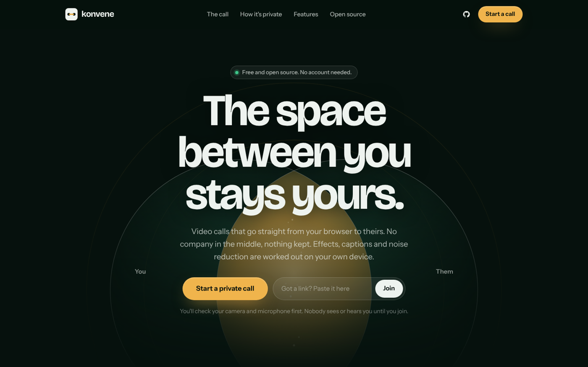
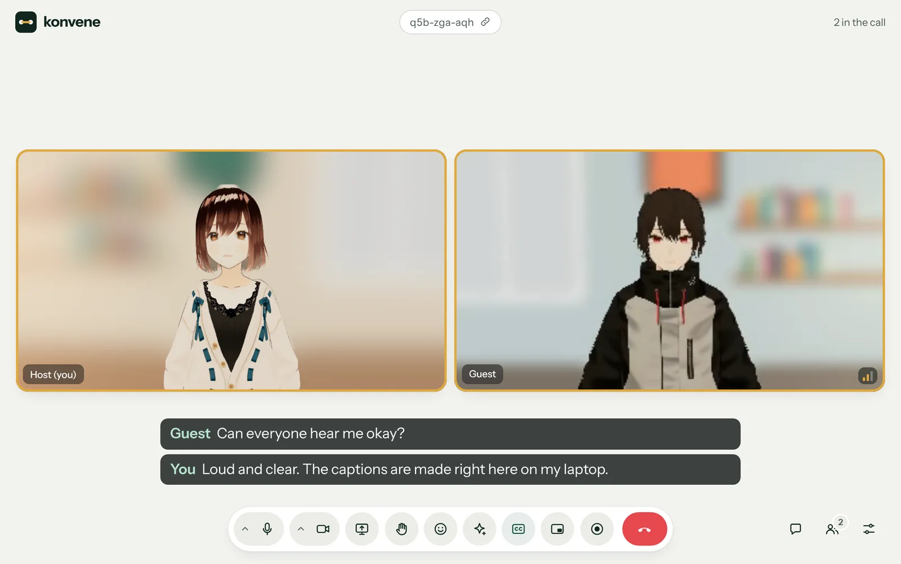

<div align="center">


# Konvene

**The space between you stays yours.**

Free, private video calls in the browser. Peer to peer, no account, no server in the middle,
and every effect, caption and bit of noise reduction worked out on your own device.

[Live demo](https://konvene.app) · [Run your own](#run-your-own) · [Customise it](docs/customising.md) · [How it works](docs/architecture.md) · [Contributing](CONTRIBUTING.md)

[](https://github.com/rakeshmenon/konvene/actions/workflows/ci.yml)
[](https://github.com/rakeshmenon/konvene/actions/workflows/codeql.yml)
[](LICENSE)

<br>



</div>

## Why Konvene

Most video apps promise to look after your data. Konvene is built so there is nothing to look after.

- **Straight to them.** Video, voice, screens and chat travel directly between browsers over WebRTC, encrypted the whole way.
- **Nothing kept.** No server records your call or your chat. Recordings are made and saved on the recorder's own device.
- **No account.** Type a name, share the link, start talking. Add a passcode, or let people in yourself.
- **No tracking.** No cookies, no analytics, no ads. The build strips MediaPipe's usage logging, and the page's Content Security Policy blocks it too.
- **Your face stays home.** Background blur, virtual backgrounds, lighting, touch-up, makeup and face warps run on your GPU before the picture is sent.
- **Recording is never secret.** It asks first and shows everyone a badge naming who is recording.
- **You decide who gets in.** Lock a call with a passcode and let people in yourself, still without accounts.

## Features



<sub>A real Konvene call. The two people are VRoid sample characters standing in for cameras.</sub>

| | |
|---|---|
| **Calls** | Up to 6 people, clean links (`/abc-def-ghj`), a pre-join page to check camera, microphone and speakers (remembers your last choices), refresh rejoins the call |
| **Who gets in** | Optional passcode (it encrypts the handshake) and asking before letting people in, with Let in and Don't let in for everyone in the call |
| **Video** | Follows your camera up to full HD; per-person quality on weak connections (down to voice only), video sized to each viewer's tile, signal indicators |
| **Sound** | Echo cancellation and noise suppression, strong noise reduction (RNNoise, on your device) or original sound for music |
| **Captions** | Live captions made on the devices in the call (Chrome on a computer), sent only to people who turn them on |
| **Background** | Blur (two strengths), virtual backgrounds, your own image, with a cutout that follows hair and leaves furniture out |
| **Face** | Smooth skin, brighter eyes, whiter teeth, slimmer face, bigger eyes, lip colour, blush, and six fun warps |
| **Light and looks** | Studio, ring light, golden hour, spotlight and more; nine colour looks |
| **Smart** | Pauses your video when you step away, keeps you in frame, fixes low light, tells you when you talk while muted |
| **Together** | Screen sharing with spotlight, chat, reactions, raise hand, pin, full screen, picture in picture, in-browser recording |
| **Devices** | Pick camera, microphone and speakers from the call controls |

### Browsers

| | Chrome, Edge | Safari (Mac, iPhone, iPad) | Firefox |
|---|---|---|---|
| Calls, effects, sharing, recording | Yes | Yes (calls tested Mac to iPhone) | Should work, not yet tested |
| Picture in picture | The whole call | One video | Firefox's own button |
| Making captions | Chrome 139+ on a computer | No, but sees others' captions | No, but sees others' captions |
| Strong noise reduction | Yes | Should work, not yet tested | Should work, not yet tested |

## Run your own

### One click

[](https://app.netlify.com/start/deploy?repository=https://github.com/rakeshmenon/konvene)
[](https://vercel.com/new/clone?repository-url=https%3A%2F%2Fgithub.com%2Frakeshmenon%2Fkonvene)

Build settings are already in `netlify.toml` and `vercel.json`. Add settings later as environment variables in your host's dashboard (see [Settings](#settings)).

### On your computer

Needs [Node.js](https://nodejs.org) 22 or newer.

```sh
git clone https://github.com/rakeshmenon/konvene
cd konvene
npm install
npm run dev
```

Open <http://localhost:8790>. To try a call on one computer, open <http://localhost:8790/?local=1> in two tabs (the handshake then runs inside the browser, no internet needed). A call between two computers needs HTTPS, so deploy it.

### Anywhere else

`npm run build` writes a static site to `dist/`. Upload it to any web host and send unknown paths to `/index.html` (call links are paths). Ready-made setups: Netlify, Vercel and Cloudflare Pages (functions and headers included), nginx (`deploy/nginx.conf`), Docker (`docker build -t konvene . && docker run -p 8080:80 konvene`). Full guide: [docs/self-hosting.md](docs/self-hosting.md).

## Settings and customising

Copy `.env.example` to `.env`, or set the same names in your host's dashboard. All optional.

| Variable | What it does |
|---|---|
| `KONVENE_NAME` | Your name for it: page titles, the wordmark, messages. |
| `KONVENE_APP_ID` | Calls only meet browsers with the same app ID. Set your own to keep your calls separate from other copies. |
| `KONVENE_MAX_PEOPLE` | Most people in one call, 2 to 8 (default 6). |
| `KONVENE_DISABLE` | Switch features off: `recording`, `captions`, `screenshare`, `chat`, `effects`, `reactions`. |
| `KONVENE_PASSCODE_DEFAULT`, `KONVENE_ASK_FIRST_DEFAULT` | New calls start locked. |
| `KONVENE_OPERATOR`, `KONVENE_CONTACT_URL` | Who runs your copy, shown on the privacy page. |
| `KONVENE_REPO_URL` | Where your copy's source lives; the site's GitHub links point here. |
| `KONVENE_RELAYS` | Your own Nostr relays for the handshake. |
| `CLOUDFLARE_TURN_KEY_ID`, `CLOUDFLARE_TURN_API_TOKEN` | **Secret.** A TURN relay for strict networks, via Cloudflare. |
| `TURN_URLS`, `TURN_USERNAME`, `TURN_CREDENTIAL` | **Secret.** Any other TURN server. |

`KONVENE_*` values are built into the page, so anyone can read them. Secrets stay on the server: the `/api/turn` function (Netlify or Vercel) trades them for relay passwords that expire after a few hours.

Your logo, icons, link preview picture and colours go in a `custom/` folder, without touching the code. See **[Customising Konvene](docs/customising.md)** and [custom.example/](custom.example).

## How it works

```
 camera ─► MediaPipe (face landmarks + person mask, on device)
        ─► WebGL2 effects (cutout, blur, light, face) ─► canvas.captureStream()
        ─► WebRTC, directly to each person in the call (Trystero, handshake over public Nostr relays)
```

There is no Konvene server in a call. The host serves static files and, optionally, one small function that hands out relay passwords. Details, including how the background cutout is cleaned up, are in [docs/architecture.md](docs/architecture.md).

## Project layout

```
src/            the app (plain JavaScript modules, bundled by esbuild)
public/         pages, styles and the MediaPipe models, copied into dist/
server/         TURN relay passwords, shared by the Netlify and Vercel functions
netlify/        Netlify function
api/            Vercel function
scripts/        local server and .env reader
tests/          end-to-end browser test (Playwright)
custom.example/ your branding: copy to custom/
deploy/         nginx config for your own server or Docker
docs/           architecture and self-hosting guides
```

## Testing

```sh
npx playwright install chromium   # once
npm run lint
npm test
```

The test runs a real two-person call in headless Chromium with fake devices: joining, muting, chat, screen sharing, recording, device switching, refresh rejoining, weak connections, noise reduction, passcodes, the waiting room, live captions (with a stand-in speech engine), and that no request leaves the site. CI runs the linter, the build and this test on every push. Set `FACE_VIDEO` to a `.y4m` video of a face to also test face tracking and effects.

## Contributing

Bug reports, ideas and pull requests are welcome. Start with [CONTRIBUTING.md](CONTRIBUTING.md); please follow the [Code of Conduct](CODE_OF_CONDUCT.md). Found a security or privacy problem? See [SECURITY.md](SECURITY.md).

## License

Konvene is licensed under the [GNU Affero General Public License v3.0](LICENSE). You may use, change and share it, including commercially. If you run a changed version for other people, you must offer them its source code.

Bundled libraries, models and fonts keep their own licences (MIT, Apache 2.0, OFL). See [THIRD_PARTY_NOTICES.txt](THIRD_PARTY_NOTICES.txt); the same notices are appended to the built `app.js`.
